# Mobile polish handoff (October 2026)

State as of 2026-10-19. This document is self-contained: it assumes no access
to the original machine's simulators, local servers, scratch folders or local
test scans. Screenshots referenced here live in
[`docs/qa/mobile-polish-2026-10/`](../qa/mobile-polish-2026-10/).

## 1. Scope and state

PR #34 (<https://github.com/nemu-pm/nemu/pull/34>, branch
`codex/mobile-review-ui-fixes`) ships the new design on iOS. The branch
`alan/appstore-wide-detail` is the same commit (`80b01432`). The stacked PR #35
(head `alan/appstore-wide-detail`, base `codex/mobile-review-ui-fixes`) was
merged into the #34 branch on 2026-10-18; all later work was pushed to both
branch names.

The PR description predates the last round: it still says Mark as Unread is
absent and that `expo install --check` fails. Both are out of date (see the
Mark as Unread and deps sections below). Update the description before review.

`git log master..origin/alan/appstore-wide-detail` is the ground truth. It
holds about 350 commits back to 2026-09-28; the October polish starts around
`b9131b81` (2026-10-13, new design on by default on iOS). The grouped summary
below lists the commits that matter.

### Liquid Glass and scroll edges

- Sheets use tinted Liquid Glass on iOS 26+ (`0883079f`); bar items take the
  platform colour so iOS draws monochrome glass items (`3984c09b`).
- One shared soft scroll edge for every scrolling surface, with a coverage
  test (`ba38ebd5`, `apps/mobile/src/design/nemuScrollEdgeCoverage.test.ts`).
- Every native scroll edge is pinned to `.soft`, because the iOS 27 SDK
  resolves `automatic` to hard (`45d2c4af`).
- The drawn edge shows nothing at rest, fades in once content scrolls under
  it, is driven on the UI thread, and is blur only with no page-colour scrim
  (`7ea82f82`). The scrim read as a dark band in dark mode.
- Beside the Duo vertical bar the edge is drawn as well (`e4ed8f38`,
  `0e8c8711`).

Code: `apps/mobile/src/design/nemuScrollEdge.ts`, `useNemuScrollEdge.ts`,
`apps/mobile/modules/nemu-scroll-edge-effect/`.

### Sheets and the ✕/✓ rule

- Edit sheets put ✕ on the left and ✓ on the right. A sheet with only a close
  button puts ✕ top right, on iPhone and iPad too (`24f06055`).
- Description "more" opens a full-text sheet (centred title, selectable
  paragraphs, ✕ top right) instead of expanding in place (`46776905`).
- Content-sized sheets take the sheet's real width; on the Duo outer display
  the margins went from about 54 pt to 17 pt (`8faf1aef`). Sheet bodies span
  the vertical bar's column (`b56d14a6`). A header padded for the bar keeps its
  title centred (`934a4eef`).
- iPad sheets are centred 540 pt form sheets (`ce0adfba`, `524686c7`).
- Source settings open in place as a sheet from the source page menu,
  unsupported Browse rows and the reader error (`fc8a3fc8`).
- Sheet scaffold max-height option; in laptop pose the plugin and
  Japanese-learning sheets stay below the hinge (`08a20b43`).
- In book pose the page beside a reader sheet stays undimmed and interactive
  (`presentationBackgroundInteraction`), and a word tapped on the page fills
  the open learning sheet (`243d5e50`, `4e5cd532`).

### Detail page

- `4195899e`: an ⓘ opens a 作品信息 (work info) sheet with icon rows (status,
  latest chapter, source, language, author, licence, every genre, added and
  last read). Genre pills and the description's licence line left the page.
- `ab5ccf38` added the first genre inline in the wide column's meta line when
  the whole line fitted. `aa42ef6e` then removed the facts strip and that meta
  line (owner's pick, option B). The ⓘ now sits beside the authors. Tags appear
  only in the info sheet; there is no inline tag on the page any more.
- The library toggle draws the system checkmark/plus at bar-button size and
  weight, in a fixed square (`4df2e4be`).
- ··· and chapter menus: Mark as Finished, Mark as Read, Mark Previous as Read,
  Share…, Copy Link (`2667b82b`), plus Mark as Unread (`74b87cc0`, see below).


### Cold-launch reveal

- The launch screen holds until the Library's first local snapshot is on
  screen (`994843f8`) and uses the page colour (`ad0dc58e`).
- The reveal scales the window 0.97 → 1 with the bars fading in and the
  Library groups rising in turn (`c76249d6`). Reduce Motion uses a 200 ms fade.
- Covers are painted before the launch screen lifts: images under it hold the
  reveal for up to 600 ms, and a cover's resolved request is remembered across
  launches (`8584ba9e`).

### Library

- iPad: larger shelf and grid covers in a window that is regular on both axes,
  150 pt minimum (an 11-inch goes from 6 to 4 columns in portrait, 10 to 7 in
  landscape). Phones, landscape phones and the Duo keep their size (`251cebe7`).
- Continue Reading on a folded Duo: each card is centred in its own pane
  (`49f62acf`). On a pose change (book ⇄ flat) the cards glide from their old
  place and width with the settle spring instead of jumping (`6383682f`).
- Dragging Continue Reading no longer aborts the app (`a49172c1`).
- 收藏夹 (Collections) opens as a pushed screen (`c655d290`).
- The new-chapters badge reverted to the old corner tab (`345258da`).

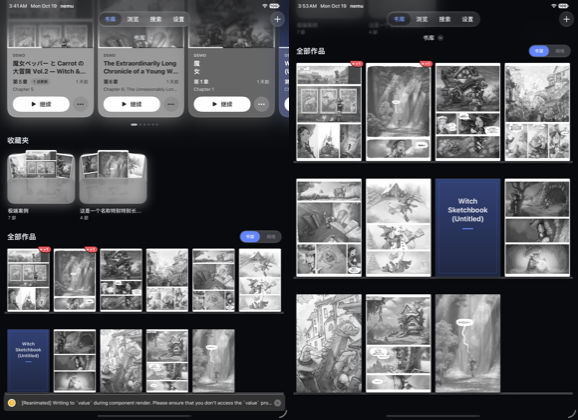

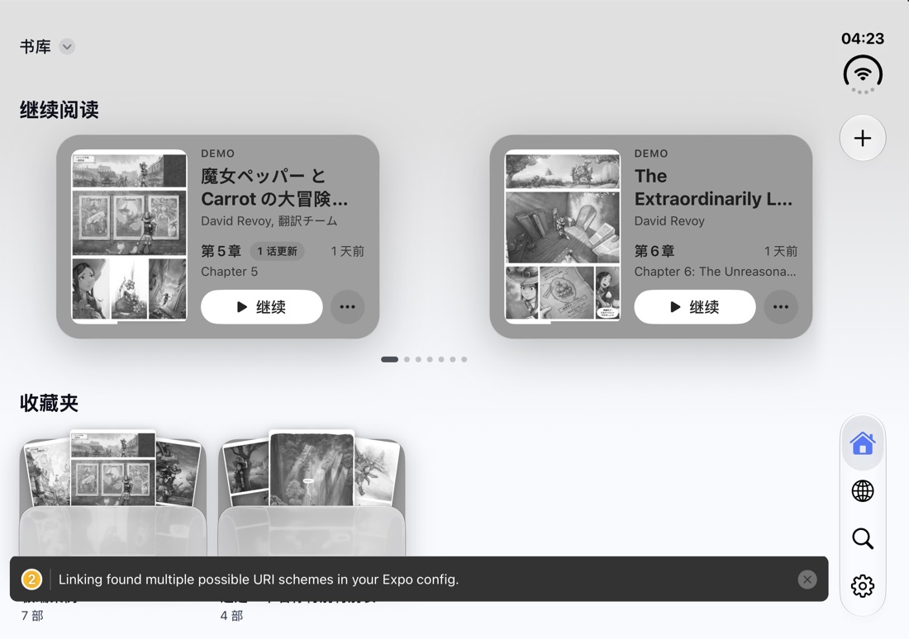

### Settings

- The split view's sidebar follows the system rule
  `clamp(width − 419, 250, 320)`: 320 pt wherever the detail still gets 419 pt,
  narrowing to 250 pt (`377fa4f9`). Book pose splits at the fold.
- Laptop (notebook) pose keeps the sidebar, split like flat portrait, 250/419
  (`5b6c275f`). Manga detail stays one column there.
- Split content sits 20 pt from the pane boundary, 40 pt from the crease in
  book pose (`81d6b46b`).
- Each column has its own title in the bar's title row: centred under a top
  bar, leading beside the vertical bar (`3a6942de`, re-measured after
  rotation, posture change, cold launch and safe-area changes: `67c97391`,
  `d26cc904`). A title next to bar buttons hugs the column's leading edge and
  reserves a fixed 60 pt (`COLUMN_TITLE_BAR_ITEM_RESERVE` in
  `apps/mobile/src/screens/SettingsScreen.tsx`, `e786f08d`). iPad keeps the
  native title.
- The sidebar uses the phone's grouped list (`07d6511d`); row titles wrap
  (`d7a2a33b`); the rule measures between the side safe areas, so the outer
  display's rail no longer eats the sidebar (`4a1b513a`).
- Fixes: Source Directories keeps Installed Sources selected (`2780f2e8`); a
  deep link closes the About sheet (`53fe453f`); the account deep link returns
  to Settings when sync is not configured (`3e75f681`); Installed Sources rows
  use the new row styles (`6b1d564f`); the Reader page's first card keeps its
  heading (`adfc2bd0`); cache rows say what they clear (`93d2783a`); the Nemu
  Agent card layout (`e36fe433`); no Cloud Sync card in builds without sync
  (`a2416f1c`); Reader page insets (`d3a685fc`).

Measured split widths (leading / trailing, pt):

| Posture / window | System | Before | After |
|---|---|---|---|
| Duo flat landscape 951×669 | 320 / 631 | 342 / 609 | 320 / 631 |
| Duo flat portrait 669×951 | 250 / 419 | 300 / 369 | 250 / 419 |
| Duo laptop 669×951 | 250 / 419 | single column | 250 / 419 |
| Duo book 951×669 | at the fold | at the fold | 435.5 / 515.7 (crease 475.5, 40 pt each side) |
| Duo outer landscape 678×466 | no system reference | 300 / 378 | 334 / 344 (250 pt sidebar beside the 84 pt rail) |
| iPad Pro 11 portrait 834 | 320 / 514 | 300 / 534 | 320 / 514 |
| iPad Pro 11 landscape 1210 | 320 / 890 | 380 / 830 | 320 / 890 |

| Before | After |
|---|---|
| 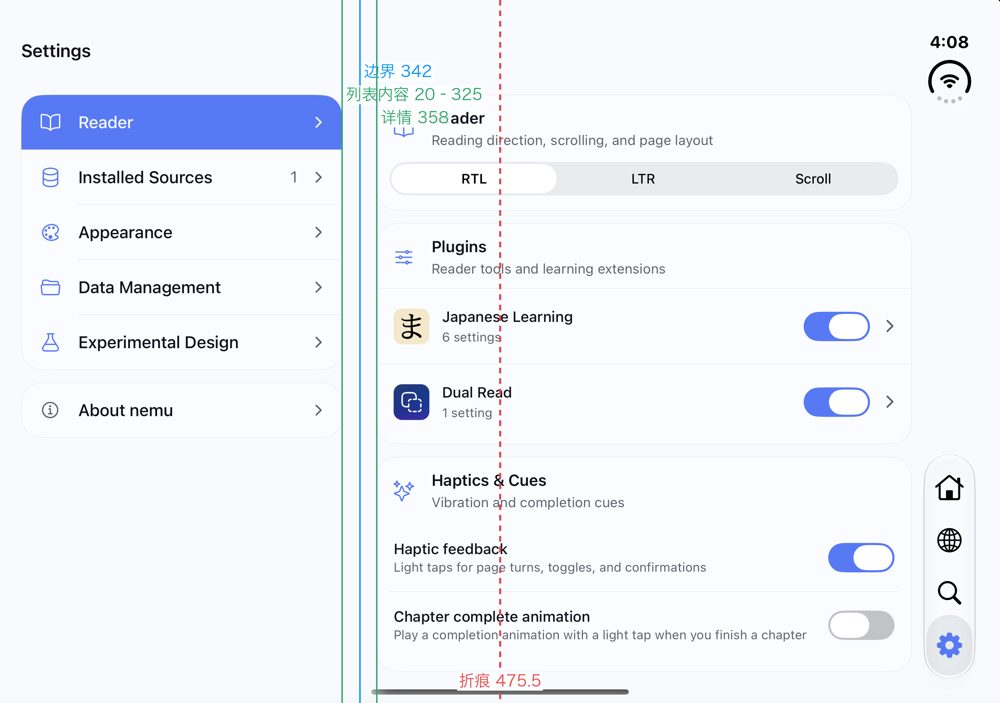 | 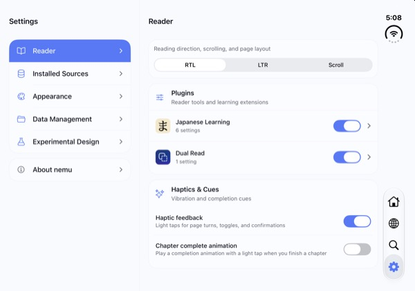 |
| 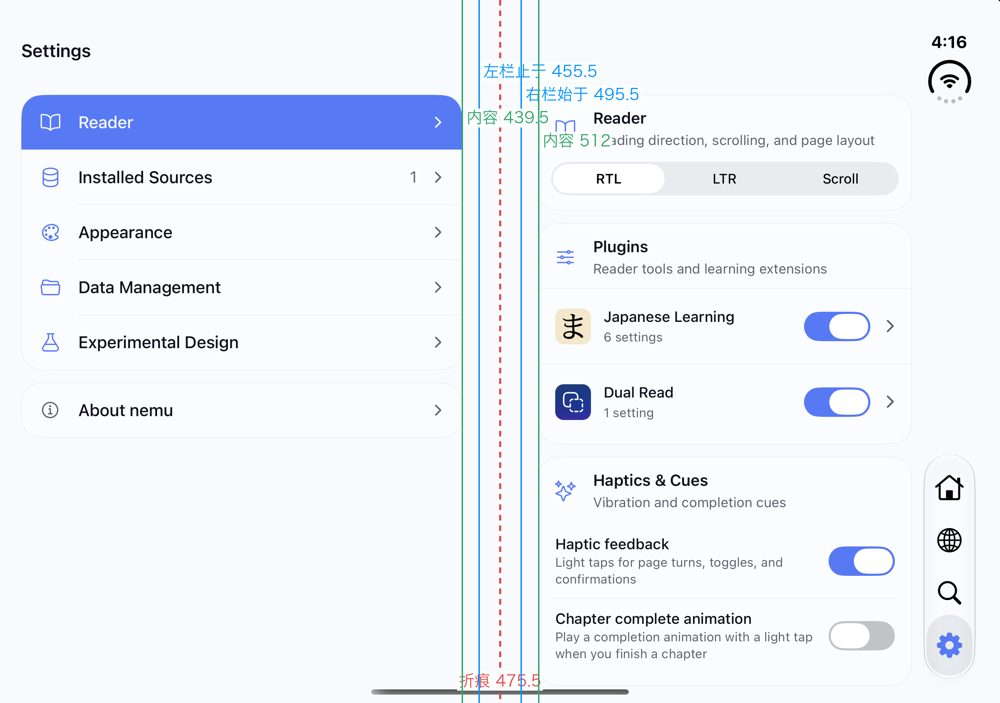 | 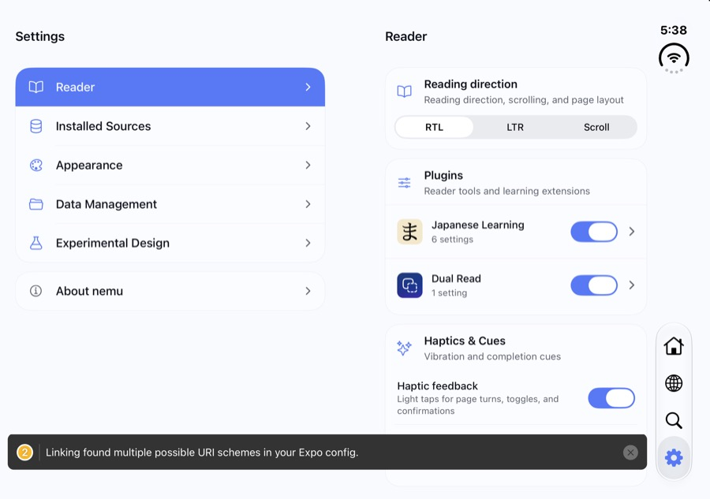 |

Other postures:
[flat portrait](../qa/mobile-polish-2026-10/settings-split-open-portrait.jpg),
[laptop](../qa/mobile-polish-2026-10/settings-split-laptop.jpg),
[outer display landscape](../qa/mobile-polish-2026-10/settings-split-outer-landscape.jpg),
[iPad portrait, native title](../qa/mobile-polish-2026-10/settings-ipad-portrait.jpg),
[Installed Sources, dark, title clear of the + button](../qa/mobile-polish-2026-10/settings-installed-sources-dark.jpg),
[book pose in Chinese](../qa/mobile-polish-2026-10/settings-split-book-zh.jpg).

### Copy

All in-app strings use Apple's own wording in zh-Hans, en and ja, taken from
Apple's system string tables wherever a term exists (for example 卷页 / Curl /
カール, 方向锁定 / Orientation Lock, 单页 / 双页 / 自动). Reader settings copy:
`31039d9e`; 翻页 options: `6eabe366`; Browse's 书库中的书源: `a2416f1c`; cache
rows: `93d2783a`; empty Library line break: `36a6acd8`. Names: Library = 书库,
Shelf = 书架, 书源, 书源目录, 收藏夹. The Laptop Mode options are 缩略视图 /
翻页控制 (the owner's wording, not Apple's 缩略图).

### Third-party notices

There is no licences screen (`d82d3b06`). `bun run notices` (in `apps/mobile`)
regenerates `apps/mobile/THIRD_PARTY_NOTICES.txt` from what actually ships
(release Metro bundle, Podfile.lock, the vendored Ichiran analyzer and
dictionary data, fonts); a config plugin bundles it at the iOS app root and in
Android `assets/`; `apps/mobile/scripts/thirdPartyNotices.test.ts` fails when a
shipped dependency is missing (`b4b2efaa`). Full CC-BY-SA-4.0 text for JMdict
and KANJIDIC2 and upstream LICENSE files for boolbase and standard-navigation
were added in `b40fc961`.

Open items: ichiran-node is FSL-1.1-MIT and redistribution permission from its
author is still pending (the owner deferred it); Android Gradle native
libraries are not enumerated; no Release `.app`/`.apk` has been inspected for
the bundled file yet.

### Dependencies

`9efcf4d3`: Expo SDK 58 latest patch round (expo 58.0.14, @expo/ui 58.0.20,
expo-router 58.0.23, react-native 0.88.0, reanimated 4.7.1, gesture-handler
3.3, screens 4.30, skia 2.14, safe-area 5.10.1, svg 15.16). Patches in
`patches/` were re-keyed; the expo-background-task patch was dropped (fixed
upstream in 58.0.11); react-native-screens is no longer excluded from
`expo install --check`. `25721437` moves to expo-router 58.0.23's names
(`expo-router/native-tabs`, `unstable_settings.anchor`). The `@expo/ui` patch
carries the form-sheet sizing, background interaction and host safe-area
changes; re-check it on every bump.

### Reader

Code: `apps/mobile/src/lib/mobileReaderPairing.ts`,
`mobileReaderPairingShift.ts`, `mobileReaderSpreads.ts`,
`mobileReaderSpreadMode.ts`, `mobileReaderPoseLayout.ts`,
`mobileReaderPageCurl.ts`, and native `NemuPageAnalysis.swift`,
`NemuPageCurl.swift`, `NemuPageCurlLeaves.swift`, `NemuOrientationGate.swift`
in `apps/mobile/modules/nemu-window-layout/ios/`.

**Placement rules**

- Fit is never cropped. The default fit is the whole page (contain) in the
  largest obstacle-free rectangle; Fit Width / Fit Height / Fill pan and are
  opt-in.
- Facing pages are fitted as one sheet: same height, meeting at the spine
  (`b8d83f06`). Automatic page layout shows a spread from a 1.25 stage aspect
  (`7d10fdf6`).
- Wide pages stand alone and parity restarts after them (`028f31dd`). Komga
  page sizes reach the reader so wide pages are known before download
  (`882184d3`).
- Page background 黑色 / 白色 / 跟随页面 (Black / White / Match Page), black by
  default (`c92286d7`); light backgrounds get dark status glyphs (`88e68931`).
- The home indicator auto-hides while the controls are hidden (`84681f4d`).
- Outer display: the page keeps clear of the camera. `28591778` removed the
  避开摄像头区域 switch; the owner then kept it, on by default (`2ca582cf`).

**Spread pairing**

- 跨页配对 (Spread Pairing) is a menu row: 自动 / 封面单独 / 封面合页
  (Automatic / Cover Alone / Cover Paired) (`2a993d49`). The default is 封面单独
  (`10a3e97d`). Automatic is opt-in.
- Native `analyzePage` measures cached page files off the main thread (size,
  binding margins, edge profiles, border colour; `a5cad878`) and, since
  `6a69c31c`, how much of the page is in colour. The cache is versioned (v2).
- Automatic parity uses binding margins and edge continuity with a Viterbi
  pass that tolerates an inserted or missing page, and abstains to the default
  without clear evidence (`9c9483dd`).
- v2 rules apply in every mode (`2bc460d4`): colour pages in a black-and-white
  chapter and strip slices stand alone; the first pair head is the first run of
  ordinary pages in the opening; the run before a wide page ends on a pair;
  binding margins count only once a certain segment confirms which way they
  point (in about one release in seven the wider margin is on the outside).
- 错开一页 (Shift by One Page) belongs to the chapter it was set on. The same
  correction on two neighbouring chapters becomes the manga's default for
  chapters without their own choice and without confident evidence
  (`ce97d47d`). Manual choice always beats automatic. Two-finger double tap
  toggles it, with a haptic and a toast (`4efe0866`).

**Page curl**

- Native `UIPageViewController` page curl hosting the reader's own pages
  (`200a571e`). 翻页 (Page Turning) is a menu row, 卷页 / 滑动 (Curl / Slide),
  curl by default (`6eabe366`). Reduce Motion falls back to slide.
- Only the page curls, not the stage, so margins stay background (`388e9af0`).
- The leaf back shows the real page it lands on, opaque and upright, instead
  of the front mirrored and translucent (`044ef277`). The curl direction
  follows the reading direction; spreads turn about the spine.
- A tap turn starts the curl natively at once, ahead of the React commit
  (55–70 ms → 1–3 ms on the simulator; `2392a3df`). Learning bubbles mount only
  on the settled page (`1568ad00`).

**Wide pages and postures**

- Portrait window: a wide page alone fits the height and pans from its
  reading-start edge; tap turns pan it a window at a time before turning, in
  slide and curl (`ed9965e1`). After the turn finishes it resets to its
  reading-start edge (`db65890e`).
- Book pose: facing pages lean on the fold edge of their own panes
  (`b8d83f06`, `c74d653f`). A wide page reads as a printed spread, split at its
  centre with one half in each pane; the curl turns it as one spread about the
  spine (`b1ef406e`).
- Laptop pose: the reader uses the top pane only; scroll mode scrolls as on
  the flat display (`2ac891cb`).
- Flat ⇄ book keeps the current page and glides the facing pages
  (`f563d39a`, `22563b24`).

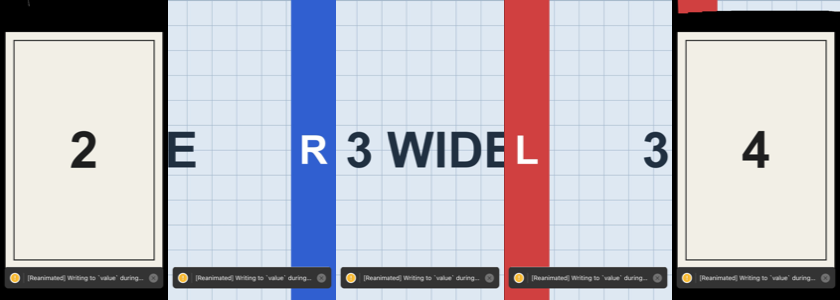

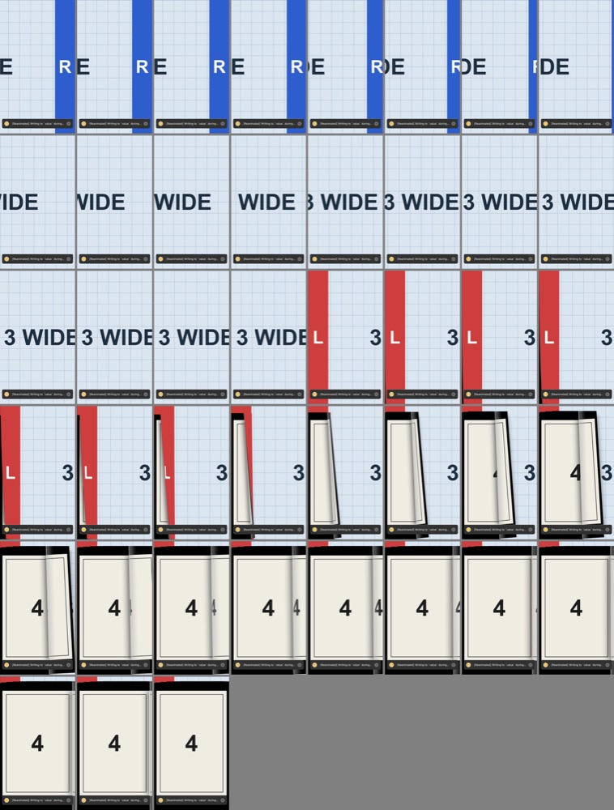

**Orientation**

- Ordinary iPhones are portrait from the first frame; the Duo and iPad rotate
  (`a45ffd02`). Info.plist allows every iPhone orientation; a native app
  delegate gate (`NemuOrientationGate.swift`) narrows an ordinary iPhone to
  portrait and widens the mask once the window's hinge reports (`fd91755e`).
- The outer display supports landscape with no special restriction, the
  reader included; only 方向锁定 (Orientation Lock) holds it (`fd91755e`).
- Remembered hinge: the gate remembers a reported hinge across launches, so a
  Duo launched sideways is landscape the first time UIKit asks; an ordinary
  iPhone clears it once JS finds no hinge (`cc6c1da6`). A hinge reported during
  launch widens the mask a moment later (`f22f2bbc`; first sideways launches
  went from 2 of 3 failing to 4 of 4 turning).
- Leaving the reader releases the orientation lock only after Back finishes
  (`061ed928`). Rotating mid-pop crashed about half the time on the outer
  display held landscape (Reanimated "Indices are wrong in Remove mutation");
  0 of 20 after the fix.

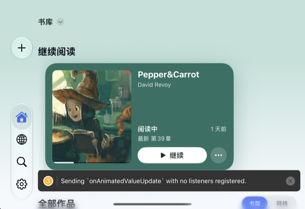

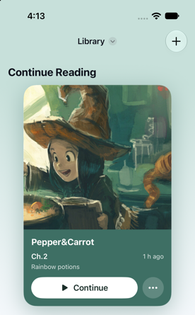

**Settings button and popover**

- The settings button draws no fill while its settings are open; only the
  glyph brightens, like the other chrome buttons (`42ac39b1`).
- The popover opens at its natural height, measured by an off-screen copy at
  the popover's width; when it does not fit, the system caps it and the Form
  scrolls from the first row (`f901a41a`, `21a7beff`).

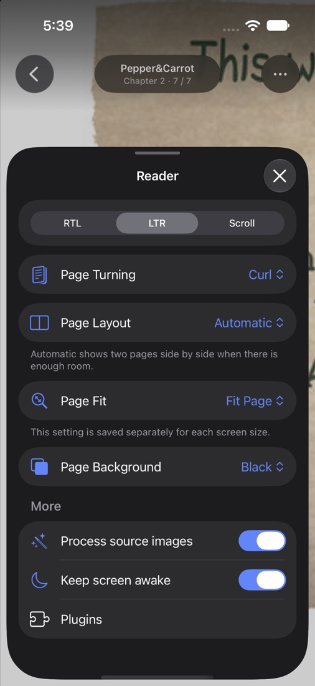

### Mark as Unread

Chapter progress used to merge by high-water mark with a sticky `completed`
and no tombstone, so a local unread was reverted by the next pull. The fix is
a per-chapter reset clock:

- `decc96e8` core: `resetAt` on chapter progress. Reading recorded at or
  before `resetAt` is discarded by `mergeChapterProgressHighWater`
  (`packages/core/src/sync-lww.ts`, `sync.ts`).
- `12689249` Convex: store resets and roll the work's summary
  (`manga_progress`) back to the newest chapter still read, or clear it.
- `690dd6df` web and `77dfe137` mobile: keep resets locally and push them only
  to a backend that advertises the protocol; a reset chapter is never the last
  read.
- `74b87cc0` UI: Mark as Unread in the chapter long press and the work's menu.
- `80b01432` rebuilt the Aidoku sandbox bundle, which includes the core merge.

Backend deployment requirements are in section 4.

## 2. Design rules the owner set

Keep these unless the owner changes them.

- **Copy.** Formal, iOS-Settings-style copy: short declarative footers, no
  colloquial phrasing. Reuse Apple's existing translations verbatim where they
  exist (zh-Hans, en, ja).
- **Scope.** No unrequested redesigns. Change only what was asked; report
  other problems instead of fixing them. The Collections (收藏夹) folder look
  (frosted pocket, fanned covers) is fixed design; do not touch it.
- **Segmented controls** only for core state (reading direction). Every other
  choice is a menu row.
- **✕/✓.** Edit sheets: ✕ left, ✓ right. Close-only sheets: ✕ top right.
- **Scroll edges.** Soft everywhere. iOS 27 defaults to hard, so pin `.soft`
  explicitly. Nothing at rest; blur fades in only once content scrolls under
  the edge; no dark scrim.
- **Orientation.** Ordinary iPhones are portrait-only, app-wide. The Duo
  (both displays) and iPad rotate. 方向锁定 shows on both Duo displays and on
  iPad, never on an ordinary iPhone.
- **Fold.** In book pose the reader keeps content off the fold, except wide
  pages, which span both halves split at their centre like a printed spread.
- **No cropping** of page margins. No automatic border trimming.
- **Outer display camera.** The page avoids the camera area by default (the
  switch stays, on by default).
- Page turn default is curl. No fast cross-fade option.
- Spread pairing default is 封面单独 until automatic pairing is validated on
  real spreads.
- Never name reference or inspiration apps in code, comments, commits or
  docs.

## 3. Dev environment

### Toolchain

- Xcode 27.1 RC (iOS 27.1 SDK, which has the iPhone Duo simulator). In Xcode
  27 the simulator window is `Xcode.app/Contents/Applications/DeviceHub.app`;
  `open -a Simulator` no longer works. Boot devices with `xcrun simctl`.
- Bun for the JS workspace. CI audits with bun 1.3.14; local bun 1.4 can miss
  nested advisories, so check with `bunx bun@1.3.14 audit --production` before
  pushing a lockfile change.
- Bundle id `pm.nemu`; the generated iOS project is
  `apps/mobile/ios/nemu.xcworkspace`, scheme `nemu`. After `app.json` changes
  run `bunx expo prebuild --platform ios --no-install` (`expo run:ios` does
  not re-sync config into an existing `ios/`).

### Install

`bun install` re-extracts patched packages and can wipe
`node_modules/@shopify/react-native-skia/libs/` and
`node_modules/expo-sqlite/ios/sqlite3.{c,h}`, which their podspecs copy in.
Always follow it with:

```bash
cd apps/mobile/ios && pod install
```

Symptoms if skipped: missing `exsqlite3_*` symbols, Skia framework errors.
Regenerating a patch with bun can also delete the patched package; reinstall
it.

### Japanese learning vendor steps (iOS)

- On-device analysis: `apps/mobile/modules/nemu-japanese-learning/scripts/vendor-ichiran.sh`
  builds the Ichiran XCFramework (Rust 1.92.0, macOS) into the gitignored
  `ios/Vendor/`. Without it the pod still builds and the app uses the cloud
  path.
- OCR models: `bun run --cwd apps/mobile ocr:models`, then `pod install`. The
  `NemuJapaneseLearning` podspec fails the build with this instruction when
  they are missing.
- Optional env: `EXPO_PUBLIC_NEMU_ICHIRAN_MANIFEST_URL` (dictionary pack
  mirror). QA flags: `docs/qa/mobile-japanese-learning-fixtures.md`.

### Dev client

Build a simulator dev client with entitlements (SecureStore needs them):

```bash
rm -rf <derivedData>/Build/Products/Debug-iphonesimulator/nemu.app
xcodebuild -workspace apps/mobile/ios/nemu.xcworkspace -scheme nemu \
  -configuration Debug -destination "platform=iOS Simulator,id=<udid>" \
  -derivedDataPath <derivedData> \
  CODE_SIGNING_ALLOWED=YES CODE_SIGN_IDENTITY="-" build
xcrun simctl install <udid> <derivedData>/Build/Products/Debug-iphonesimulator/nemu.app
```

- Pass exactly those two signing flags. Adding `CODE_SIGNING_REQUIRED=NO` or an
  empty provisioning profile breaks the entitlements again. Remove the old
  `.app` first: an incremental build skips the codesign phase.
- Never re-sign afterwards with `codesign --force`; the app then fails to
  launch.
- A cold build takes about 15 minutes. Run it in the background; keep
  foreground commands short.
- Rebuild whenever native code changes (`modules/`, patches touching Swift,
  config plugins). A JS-only change needs only Metro.

### Metro

```bash
cd apps/mobile && bunx expo start --dev-client --localhost --port 8081
xcrun simctl spawn <udid> defaults write pm.nemu RCT_jsLocation localhost:8081
xcrun simctl openurl <udid> "nemu://expo-development-client/?url=http%3A%2F%2Flocalhost%3A8081"
```

- Use `--localhost`; a VPN or TUN LAN address can truncate bundles.
- Do not start Metro with `CI=1`; it freezes the file map.
- Check who owns the port (`lsof -iTCP:8081`) before starting or killing
  Metro.
- Deep links are the reliable way to navigate in tests: `nemu://library`,
  `nemu://browse`, `nemu://settings/reader`,
  `nemu://sources/<registryId>/<sourceId>/<mangaId>[/<chapterId>]`.

### Duo postures in the simulator

The iPhone Duo simulator has an outer display (466×678 pt) and an inner
display (669×951 pt portrait). Postures can be set from the CLI through the
native HID addon of `serve-sim`, which the `expo-device-hub` npm package
(0.13.0) vendors under `vendor/serve-sim/dist`. Its `SimHID` class exposes
`setHingePose("open" | "closed" | "book" | "laptop")`, `hingeState()` and
`orientation(n)`:

```js
// node pose.cjs <udid> pose book   (SERVE_SIM_DIST points at vendor/serve-sim/dist)
const m = require(process.env.SERVE_SIM_DIST + "/native/serve-sim-native.node");
const [udid, cmd, arg] = process.argv.slice(2);
(async () => {
  const h = new m.SimHID(udid);
  const call = async (f, ...a) => { const r = h[f](...a); return r && r.then ? await r : r; };
  if (cmd === "pose") console.log(await call("setHingePose", arg));
  if (cmd === "orientation") console.log(await call("orientation", Number(arg)));
  await new Promise((r) => setTimeout(r, 1500));
  console.log(JSON.stringify(await call("hingeState")));
  process.exit(0);
})();
```

- Screenshots: the Duo has two displays. Get the display id from
  `xcrun simctl io <udid> enumerate` and pass `--display=<id>` to
  `xcrun simctl io <udid> screenshot`; the wrong display comes out black.
- `simctl recordVideo` stops at a display switch.
- Synthetic drags cannot trigger the interactive edge-swipe pop; check it by
  hand.
- **The simulator reports no fold region in book or laptop pose.** The hinge
  state is `partiallyOpen` but the reserved-region list has no division, so
  the app lays out as if flat. Book and laptop geometry is covered by unit
  tests (`mobileReaderPoseLayout.test.ts`, `mobileReaderBookSpread.test.ts`,
  `mobileSplitPaneLayout.test.ts`) and was checked visually with a dev-only
  fake fold.
- **Fake fold (dev only, never commit).** In the JS wrapper of the window
  layout observer (`modules/nemu-window-layout/src/WindowLayoutObserver.native.tsx`),
  intercept the regions event: when the hinge is `partiallyOpen`, there are no
  divisions, and the window is landscape and wider than 800 pt, add one active
  vertical division about 24 pt wide centred on the window before passing the
  event on. Keep it as an uncommitted local change and revert it before any
  commit or screenshot meant as evidence of real behaviour.

### Gates

From the repository root:

```bash
bun run typecheck      # read the output; no "error TS"
bun run lint           # 0 errors (about 286 existing warnings)
bun test               # root, ./tests and packages/core
cd apps/mobile && bun test --timeout 20000
```

The last local mobile run had about 4,400 tests. One test,
`scripts/thirdPartyNotices.test.ts` > "every package in the Aidoku sandbox
bundle is listed", fails locally on bun 1.4 with
`EBADF: bad file descriptor, posix_spawn …/node_modules/.bin/esbuild`. It
passes on CI's bun 1.3.14. Treat that one failure as environmental; anything
else is real.

CI on PR #34: "Detect native changes" passed; the Vercel preview fails and the
owner said to ignore it. The other jobs were pending at the time of writing.

## 4. Backend: not deployed (document only)

Nothing in this section has been deployed. Deploy only after the owner
approves, and after PR #34 merges.

### Mark as Unread

Deploy Convex **before** shipping any client build from this branch to users.

- Schema (`convex/schema.ts`): adds optional `chapter_progress.resetAt`
  (number, the sync clock of the newest Mark as Unread) and makes
  `manga_progress.lastReadSourceChapterId` optional (absent once every chapter
  of a work is unread). Both are additive or relaxing; no backfill.
- Capability: the backend advertises
  `chapterProgressIntraPageVersion: CHAPTER_PROGRESS_SYNC_VERSION` (now 2).
  Clients send `resetAt` only when the version is a safe integer ≥ 2
  (`supportsChapterProgressResetSync`). Against an older backend, mobile and
  web keep the reset locally and push it once the backend advertises 2.
- Server merge (`convex/history.ts`): a write recorded at or before a stored
  reset is discarded and does not become the work's last read; a discarded or
  repeated write skips the patch so old clients re-pushing it do not wake
  subscribers. A reset batch rolls each work's summary once.

Residual risks with old clients (builds without the reset protocol):

- They ignore `resetAt` and keep their local high-water copy, so the chapter
  still shows as read on those devices.
- If such a device records reading on that chapter after the reset (a newer
  clock), the reading wins and the chapter becomes read everywhere again. That
  is correct by the rules but can look like Mark as Unread did not stick.
- They re-push the old row with its old clock; the server discards it.
- A work summary without `lastReadSourceChapterId`: the core types on `master`
  already treat it as optional, but verify that the builds currently in users'
  hands render Continue Reading correctly when it is absent.
- Rolling Convex back to a schema without `resetAt` after rows carry it will
  likely be refused by schema validation (status unknown, verify before any
  rollback plan).

### Other undeployed backend items

Per the 2026-10-19 handoff notes these are not deployed. The production state
could not be checked from here; verify each.

| Item | Where | Status |
|---|---|---|
| Settings fields `selfHosted`, `sourceDirectories`; `r2_uploads` table | `convex/schema.ts` | not deployed; deploy before clients that write them |
| Account deletion with Sign in with Apple token revocation | `convex/accountDeletion.ts`, `accountDeletionRun.ts`, `appleRevoke.ts` | not deployed; the production end-to-end check (delete an Apple account, token revoked) has not been run |
| Auth on AI actions (`requireAuth` in `ai_metadata.*`, `japanese_learning.normalize`) | `convex/`, `tests/convex-ai-actions-auth.test.ts` | not deployed |
| OCR gateway (JWT check in front of `ocr.nemu.pm`) | `services/ocr-gateway` | not deployed; the OCR host has no server-side auth until it is |
| 30-day log retention claimed by the privacy page | `docs/app-store/log-retention.md` | not in place: needs the Convex log stream (Axiom, 30-day dataset) and the OCR host log rotation (`services/ocr/logrotate.conf` via `deploy.ts`) |
| `APPLE_CLIENT_SECRET` expiry | `scripts/generate-apple-secret.ts`, `docs/app-store/release-checklist.md` | the JWT expires after at most 180 days; current expiry date unknown, verify. Whether `APPLE_NATIVE_CLIENT_SECRET` and `APPLE_APP_BUNDLE_ID` are set in production is also unknown |

## 5. Unverified

- Real-device book and laptop posture (the simulator has no fold region).
- Curl smoothness at 120 Hz, and tap-to-curl latency on a device.
- The Continue Reading glide on a real fold.
- Pinch zoom on a split wide page in book pose: each half zooms on its own.
- iOS 26 iPhone SE: a 20 pt strip artefact after a curl turn.
- Settings column-title timing on a normal (not loaded) machine, and the fixed
  60 pt clearance for the + button with other bar items or text sizes.
- Android: no page analysis (`analyzePage` is iOS only, so Automatic pairing
  and Match Page background have no data there); Settings and the reader not
  verified on Android.
- VoiceOver reading order on the new screens.
- zh/ja screenshots across the app. The iOS 26.0 simulator lacks PingFang and
  shows tofu; confirm CJK rendering on a real iOS 26 device.
- Mark as Unread was never run on a simulator; it is covered by unit tests
  only.
- The web app has no Mark as Read / Mark as Unread UI.
- Automatic pairing v2 was not checked in the reader with real spreads.
- `nemu://library` while the reader is open used to leave the reader up; the
  final-fixes round checked deep links on several devices but the result is
  not recorded in a commit. Status unknown, verify.

## 6. Open owner decisions

- **`alan/opt-settings-no-divider`** (pushed, not merged; `fd7814a2` on top
  of `d26cc904`): a system-style lighter sidebar surface with no hairline,
  running to the crease in book pose. Caveats: in dark mode the grouped rows
  blend into the sidebar, and in light mode the contrast between sidebar and
  detail is small.

  | Light | Dark |
  |---|---|
  | 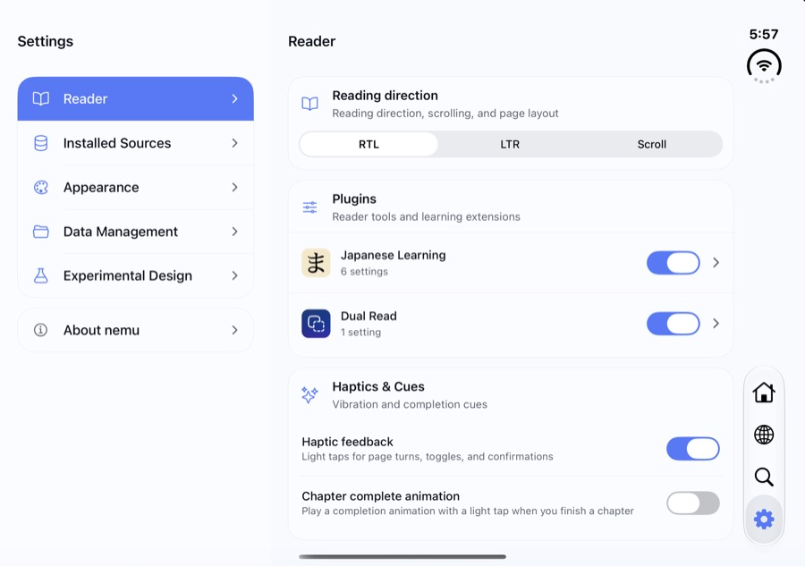 | 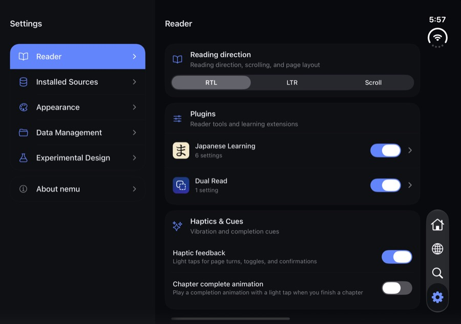 |

- **iPad Settings column titles.** iPad has none, deliberately: the floating
  tab bar sits in that row and iPad keeps the native title.
- **Reader settings sheet on the outer display.** Its ✕ sits in the vertical
  bar (rail) column.
- **Automatic pairing v2 as the default.** Measured on a local corpus of 556
  units (24,856 pages, 149 works; scanlation chapters in en/zh/ja, volume
  scans, webtoon strips, an open-source webcomic as control), held-out set of
  273 chapters / 3,186 decisions:

  | Strategy | Overall accuracy | Decides | Confidently wrong |
  |---|---|---|---|
  | 封面单独 (cover alone), fixed | 45.5% | 0% | n/a |
  | 封面单独 + v2 rules (shipped default) | 64.1% | 0% | n/a |
  | Automatic v1 | 75.7% | 92.6% | 18.9% |
  | Automatic v2 | 65.7% | 7.9% | 0.5% |

  v1 was confidently wrong 23.4% of the time on volume scans, where the wider
  margin is often outside. v2's extra decisions mostly come from the
  wide-page anchor rule, whose ground truth was built from the same premise.
  The recommendation was to keep 封面单独 with v2 rules until v2 is checked
  against independent ground truth such as printed page numbers. The corpus
  is local only and must never be committed or published.

## 7. Known dev-only warnings

Seen in LogBox during the verification runs; none appear in release builds.

- Reanimated: "Writing to `value` during component render". One source was
  fixed (`1eb444f6`); others remain.
- "Sending `onAnimatedValueUpdate` with no listeners registered."
- A LayoutAnimation warning about an undefined value on iPad when going back.
- "Linking found multiple possible URI schemes in your Expo config" (visible
  in most screenshots).

## Screenshot credits

Screenshots are from the iOS simulator. Artwork visible in them is from
Pepper&Carrot by David Revoy (<https://www.peppercarrot.com>), licensed CC BY
4.0, including its Japanese translation by the Pepper&Carrot translation
team. The numbered "Wide Page Test" pages are synthetic test images. No other
artwork is included.
