# PR #34 — Expo SDK 58, iPhone Duo / foldable adaptation, reader redesign, on-device Japanese learning

Verified 2026-09-26 → 2026-09-28 on Xcode 27.1 (iPhone Duo iOS 27.1, iPhone 17 Pro iOS 27),
Android API 36 (phone + Pixel Fold emulator). Screenshots in [`pr-34/`](pr-34/).

## Platform

- **Expo SDK 58** (`58.0.0`, React Native `0.88.0-rc.3`): dependency + patch migration
  (`patches/*@58*`), JSC main runtime + Hermes worklets, scene lifecycle.
- **Window geometry** (`modules/nemu-window-layout`): iOS `UIView.reservedRegions(kind:)`
  (fold divisions, camera occlusions), `UIHingeInteraction`, `verticalBarEdge`, safe areas —
  event-driven, no polling. Android Jetpack WindowManager `FoldingFeature` (book / tabletop; a
  zero-width Pixel Fold hinge becomes a 20pt logical fold). Shared contract
  `src/lib/mobileAdaptiveLayout.ts` (width class, posture flat/book/notebook, fold panes), tested
  against measured Duo geometry (`tests/fixtures/iphone-duo/safearea-measurements.json`).
- **Reader vertical bar**: `UIViewController.preferredVerticalBarBehavior = .disabled` for the
  reader only (Apple: full-screen media UIs), so the status bar is horizontal and no side column
  is reserved.
- **Motion**: pose veil for display/size-class switches, UI-thread glides for fold changes,
  scroll anchors kept, Reduce Motion = fade.

## Screens

- Fold-aware even-column grids (no card on the fold), detail two-pane split (design "A" header
  with tag sheet), Settings split view, Search sidebar (sources + counts + recents) on regular
  width, empty-state hero sized per pane (no jump between book and flat), glow no longer clipped,
  rows never bleed into the Duo bar column, Back restored for tab stacks built without `index`.
- Android: progressive blur/fade under the floating tab bar (`modules/nemu-scroll-edge-effect`,
  AGSL RenderEffect, fade fallback), Material 3 sheet metrics (`src/design/sheetMetrics.ts`),
  sheets width-capped and placed in one pane in book posture.
- iOS sheets size to the sheet's own width (`@expo/ui` patch); About sheet no longer scrolls.

## Reader

- Photos/Safari-style Liquid Glass capsule row (UIKit glass, grouped container), full-bleed pages
  per pane, top-edge scrim for status legibility, native dark settings popover → sheet when it
  doesn't fit, dark docked learning panels.
- Book: one page per half. Notebook: page (or two-page spread) in the top pane; bottom pane =
  trackpad / spoiler-safe filmstrip / study desk / continuous scroll (setting "Notebook layout").
- Duo features: bilingual side-by-side (dual reader), book spine + page flip, display handoff toast.

## Japanese learning

- UI ported 1:1 from web (auto-detect transcript, sentence furigana + POS colours, token details,
  Ask → chat handoff, bubble preview).
- **On-device engine** (`modules/nemu-japanese-learning`): Apple Vision OCR (iOS 18+) with our own
  bubble grouping / manga reading order; tiger's Rust Ichiran (`TigerHix/ichiran-node@35dcfdc`,
  format-1 pack `portable-core-260118-baseline`, 25 MB on-demand download with progress) mapped
  to the existing `/api/segment` contract (12-sentence contract test, field-exact except gloss
  count). Engine setting Automatic / On device / Cloud; no uploads in on-device mode.
- Open-source licenses page (Settings → Open-source licenses).

## Final local checks

| Check | Result |
| --- | --- |
| `bun run typecheck` (app + Convex) | pass |
| `apps/mobile` `tsc --noEmit` | pass |
| `bun run lint` | 0 errors (253 pre-existing warnings) |
| `bun test` (root) | 362 pass / 0 fail |
| `apps/mobile` `bun test` | 3170 pass / 0 fail |
| `vite build` (web) | pass |
| iOS Release (Xcode 27.1) | build + install on Duo and iPhone 17 Pro |
| Android `assembleRelease` | pass; installed on phone + Pixel Fold emulators |

Device pose pass on the Duo: book, open landscape, open portrait, notebook, closed — Library,
Browse, Search, Settings, source home, detail, reader (`pr-34/duo-poses-*.jpg`).

## Known gaps / follow-ups

- Real-device performance (OCR latency, memory, thermals) not measured — simulators only.
- On-device engine is iOS-only; Android keeps the cloud path (ML Kit + JNI planned).
- The Ichiran XCFramework is not committed (`modules/nemu-japanese-learning/ios/Vendor/` is
  gitignored); release/CI must run `modules/nemu-japanese-learning/scripts/vendor-ichiran.sh`
  (Rust 1.92.0) or builds fall back to cloud analysis.
- ichiran-node licensing (root FSL-1.1-MIT vs crate MIT) to be confirmed with the author; the
  adapter uses an internal legacy-output hook that should become public API upstream.
- Duo pose transitions are now scripted through the simulator HID harness (2026-10-12).
  The earlier OCR check returned 521; OCR was outside this UI follow-up.

## 2026-10-12 UI continuation

The selected wide title-page layout uses a top hero and one chapter list, with a 340pt Continue button. Library keeps its existing design. Source home uses separate glass tabs and the shared cover palette; portrait single-card windows centre every snap, including the last card, while short/wide windows lead from the page gutter.

Notebook reader now uses the selected 8pt floating sheet. Its title is centred between equal-width toolbar regions. The leading glass capsule contains an icon-only back arrow, which exits the reader. The trailing toolbar ends in ×, which closes only the panel and restores the ordinary full-display reader; an up chevron in the same position reopens it. Native glass capsules use their own material animation; removing opacity/perspective animation from their ancestors fixes the missing Liquid Glass after mounting or reopening.

The filmstrip is vertically centred between its toolbar and scrubber. Visible neighbouring pages share the page cache and request queue at prefetch priority, with cancellation for offscreen cells. A saved “Hide unread previews” option restores spoiler protection based on saved progress and pages visited this session; preview requests remain protected until that preference has loaded. Thumbnails show a delayed skeleton, fade in after image decoding, and expose retry on failure. Page numbers remain visible in every state. Page layout, cover pairing and page fit use consistent native menu rows; the settings sheet retains its existing structure.

Validation: mobile typecheck passes; lint has 0 errors and 63 existing warnings; `bun test --coverage` passes 3,905 tests across 400 files. Simulator screenshots cover source tint/alignment, notebook glass, panel close/reopen, and the selected sheet gutter. Device performance and network-load behaviour still need real-device measurement.

Local visual artifacts (under `artifacts/design-explore-20261003/compare16/`): `18b-source-home-tint.jpg`, `18c-source-home-five-colors.jpg`, `21-proto-sourcehome.jpg`, `24e-notebook-toggle.jpg`, `24f-reader-previews-settings.jpg`, `24g-notebook-back-close.jpg`. Source-home A–D comparisons are separate prototypes and are not included in this PR.

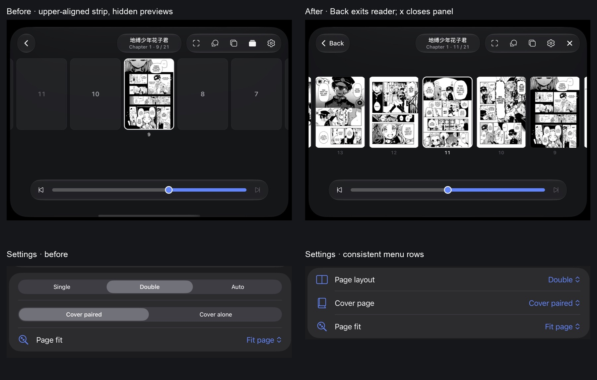

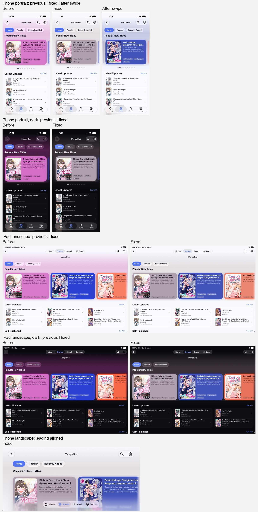

Interaction follow-up: verified the saved spoiler switch survives relaunch. Delayed thumbnail loading was exercised with a temporary simulator-only verification bundle; no test delay is included in production. Notebook navigation follows the iPhone Duo guidance to keep controls reachable and retain their relative positions, while text and distinct symbols separate reader navigation from panel dismissal.

### Duo source loading and misplaced blur (2026-10-12)

Source listing/search skeletons now consume the loaded grid's layout directly,
including column count, cell widths, fold margins and toolbar safe-area insets.
They no longer remeasure the empty-list container independently.

Native scroll-edge effects follow toolbar placement on the tab stacks and their
screen overrides: with a left/right rail, the horizontal top/bottom effects are
hidden; returning to horizontal bars restores the normal soft edges. This fixes
the blurred resting source-manga title and Settings detail-pane controls.

Validation: mobile typecheck passed; lint has 0 errors / 63 existing warnings.
Full coverage run: 3906 passed, 2 i18n source-audit timeouts under concurrent bundle
build load. Rerunning that audit alone passed all 4 tests. Native-header tests cover
both rail sides, returning to horizontal bars, and unchanged Android behavior.

Verified source detail and split Settings on an expanded landscape Duo:

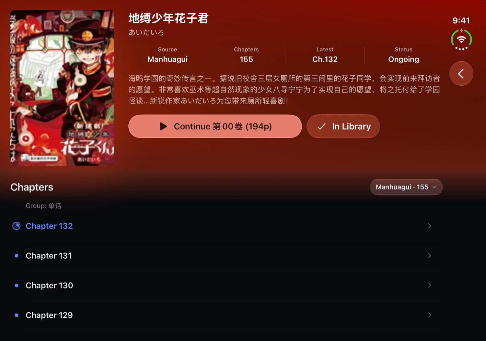
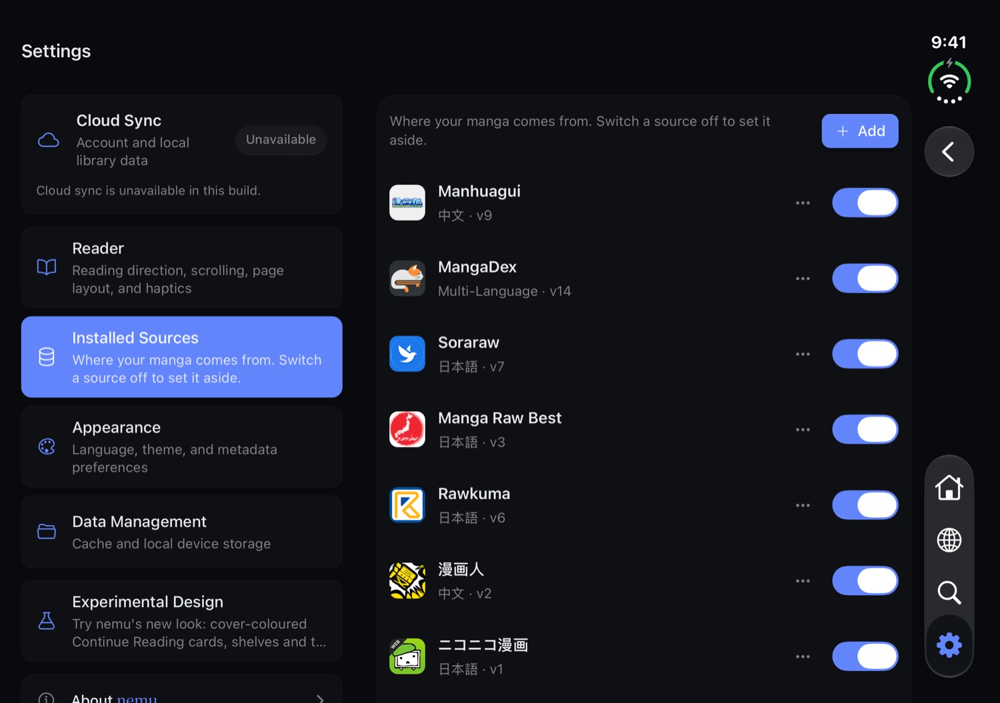

The result-grid skeleton was held visible using a temporary QA-only header;
its last column ends at the same content edge as the loaded grid, before the
right-side toolbar. The override was removed, and the user simulator runs the
production bundle. Focused edge/gutter/grid suite: 45 passed, 150 expectations.

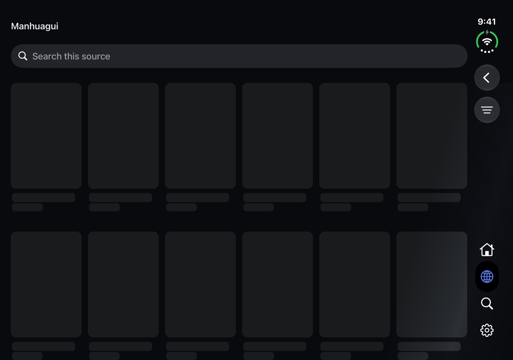

### Settings default position and tab switching follow-up (2026-10-12)

The previous blur check missed two split Settings issues: selecting a section
called `scrollToOffset(0)`, which scrolled past UIKit's adjusted top inset, and
heading deduplication hid a section title even though the shared navigation bar
only displayed Settings. The detail list now initializes afresh for a different
section (preserving the settings state above it), and section titles remain
visible in the detail pane.

Verified on the user's expanded landscape Duo with the updated production
bundle: cold Settings entry, Reader → Installed Sources → Appearance → Installed
Sources, all header text and Add visible by default, the last source and import
action reachable by scrolling, and the scrolled position retained through Search
and back. Recorded Browse / Search / Settings first entry and return transitions;
reviewed sampled transition frames without reproducing a content-position jump.
This is verification of those paths, not a claim about every fold/rotation path.

Mobile typecheck passed; lint: 0 errors / 63 existing warnings; settings-heading,
settings-split and page-layout tests: 18 passed (54 expectations).

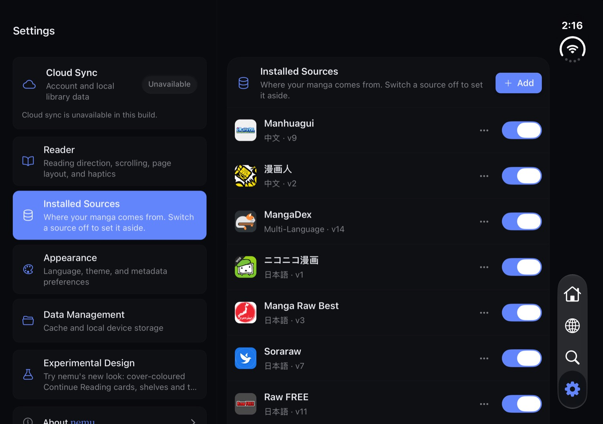

### About centering and Settings grouping (2026-10-12)

About centers its content within the sheet's own width, including on the Duo
outer display where the background page has a trailing toolbar safe area. A
fitted Expo sheet now expands its SwiftUI frame before ignoring horizontal safe
areas; otherwise its intrinsic-width host remains centered in the inset region.
The change only applies to callers explicitly ignoring both horizontal edges.

Open-source licenses now opens directly from Settings, below About. Experimental
Design belongs to the main preferences group, separate from those information
entries. About keeps the icon, version, description and Source Code link; its
height estimate now includes only that single link row.

Verified closed portrait Duo: About centered on its grabber, new Settings groups,
and direct license-sheet presentation; About stayed centered after unfolding
to landscape and returning closed. Mobile typecheck passed; lint has 0 errors
and 63 existing warnings; About, licenses and Expo patch checks: 25 passed.

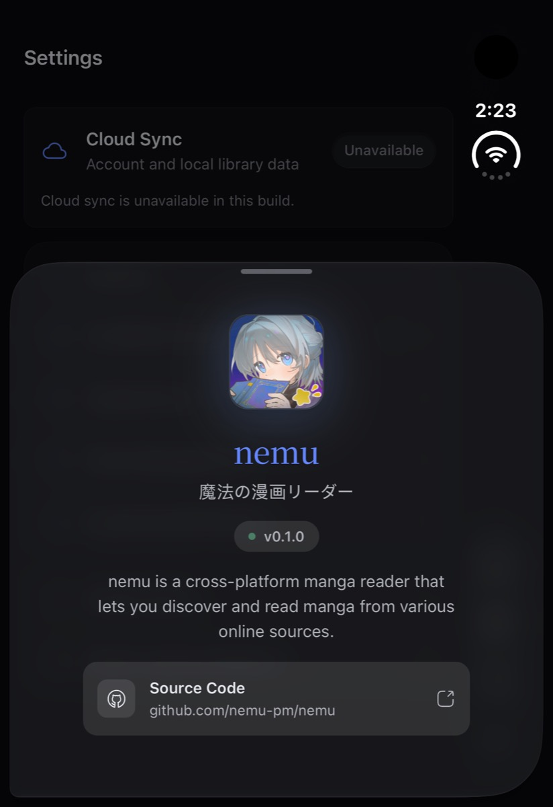
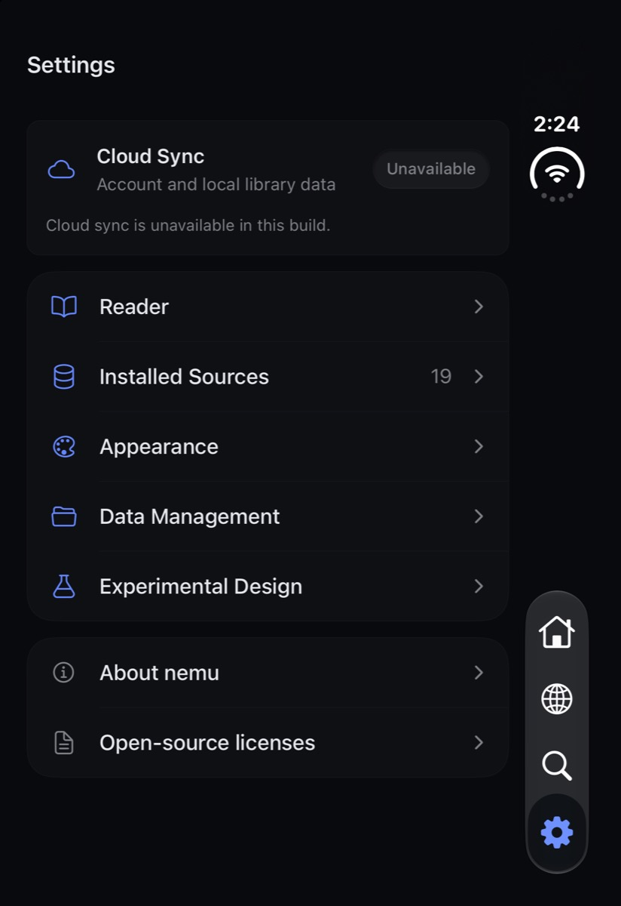

### Outer Reader canvas and native lifecycle fixes (2026-10-12)

The full-screen outer display now draws manga behind the existing vertical
controls, excluding the interior hardware-camera region. Candidate rectangles
are compared by contain-fitted manga area (using the current page aspect ratio
and spread setting), rather than by empty rectangle area. The edge-attached
status-bar region does not resize pages when chrome hides. No extra symmetric
page gutter is added on this display. The original Back/action rail and bottom scrubber
keep their safe-area positions; showing/hiding controls does not resize the
page. Split View keeps its inset stage. The title glass sizes to its text within
the existing title slot, including the notebook upper pane.

The status-bar request was already correct in Reader. LLDB inspection found a
later `NemuTransitionProbeController` after the root native stack, causing
Screens' last-child-only lookup to return nil. The Screens patch searches
backwards for its navigation child so `statusBarHidden` and style reach UIKit.

The user simulator's 13:59 crash and the QA simulator's 14:04 crash both point
to Reanimated 4.7.0 `startLayoutAnimation`, at `parent->current.tag` (address
0x104). A queued layout update can outlive its parent during a mounting
transaction. The versioned patch locks and checks the weak parent before
starting that animation. The original user gesture is unknown; this fixes the
specific recorded null-parent path, not every possible native crash.

Checks: mobile typecheck; lint 0 errors / 63 existing warnings; coverage suite
3914 passed, plus the 2 isolated native/sandbox policy checks passed.

Reader settings now saves an outer-display choice: Avoid camera (default) or
Full-screen immersion. Immersion expands the page stage without moving the
original controls; it does not force an aspect-fill crop. Flat inner-display
single pages also lose the extra 24pt horizontal gutter. Portrait remains one
page even with Double saved; landscape restores the saved spread choice.

Built the native patches with Xcode 27.1 RC (27A9275) and installed in-place on
the user's playable Duo, preserving app data and the existing OCR model bundle.
Verified inner portrait whole-page reading, intrinsic title glass, camera mode
picker, outer camera clearance, controls/status visibility and status restoration
on returning to Library. No new nemu crash report appeared during this round.
The old SimHID orientation call could desynchronise the 3D preview from the app;
using setPhysicalOrientation on the current simulator correctly rotates the scene.

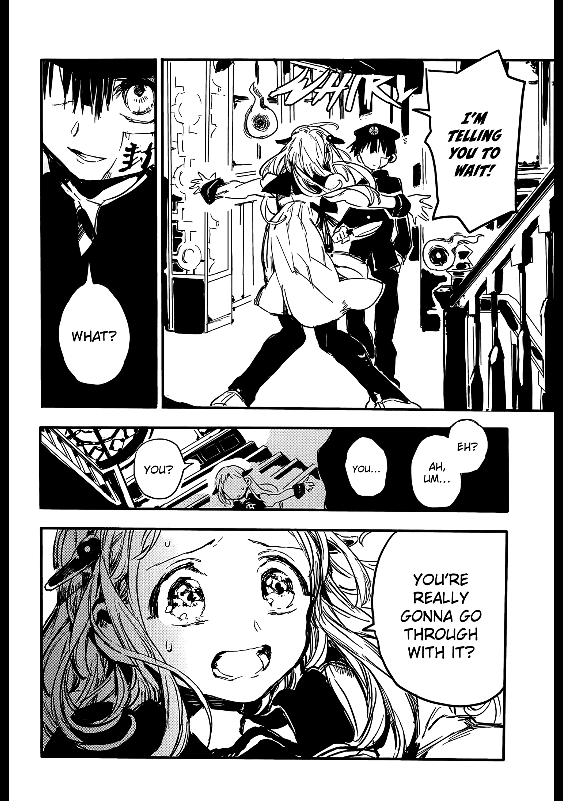
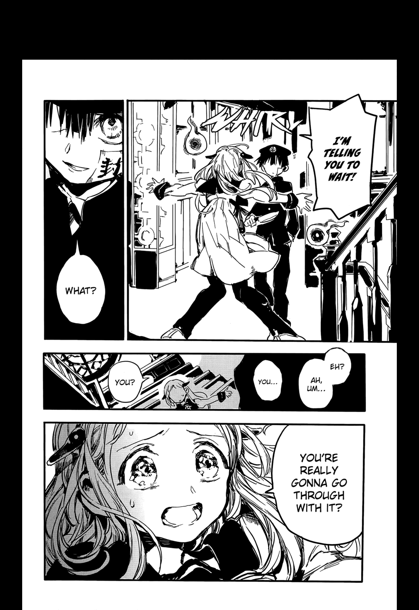

Both outer-display modes were selected through the native settings menu and
checked with controls visible/hidden. Avoid camera was restored afterwards.

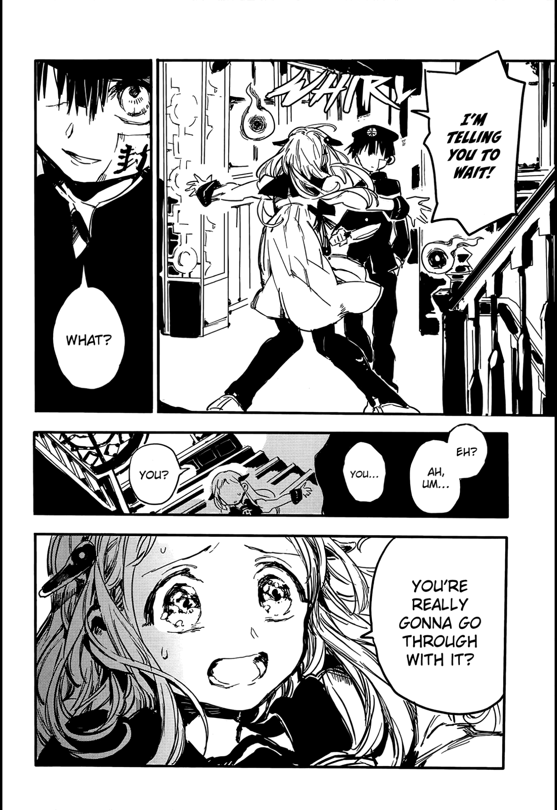

### Stable Library header across display changes (2026-10-12)

Library's column-count key previously remounted its entire FlatList, including
Continue Reading. The carousel restarted with a 1pt row while measuring its
width and card text, then expanded and pushed Collections/the shelf down.
Library now virtualizes explicit cover rows inside one persistent list. Column
changes regroup the covers without discarding the carousel, folders or their
measurements. Row viewability is converted to cover indices for scroll-anchor
restoration. Render batch sizes still target approximately 18 covers.

A programmatic carousel offset clamp (all cards fit after unfolding) now keeps
the selected card, so folding back restores it instead of selecting card zero.
Regression coverage includes grouped-row anchoring and the carousel round trip.
Mobile typecheck passed; lint: 0 errors / 63 existing warnings; mobile coverage:
3916 passed (the two isolated native/sandbox checks were unchanged).

Verified on the installed Duo build by selecting the second Continue Reading
card, unfolding to two visible cards, then folding back. The list header stays
mounted and the selected card/cover wash remain selected.

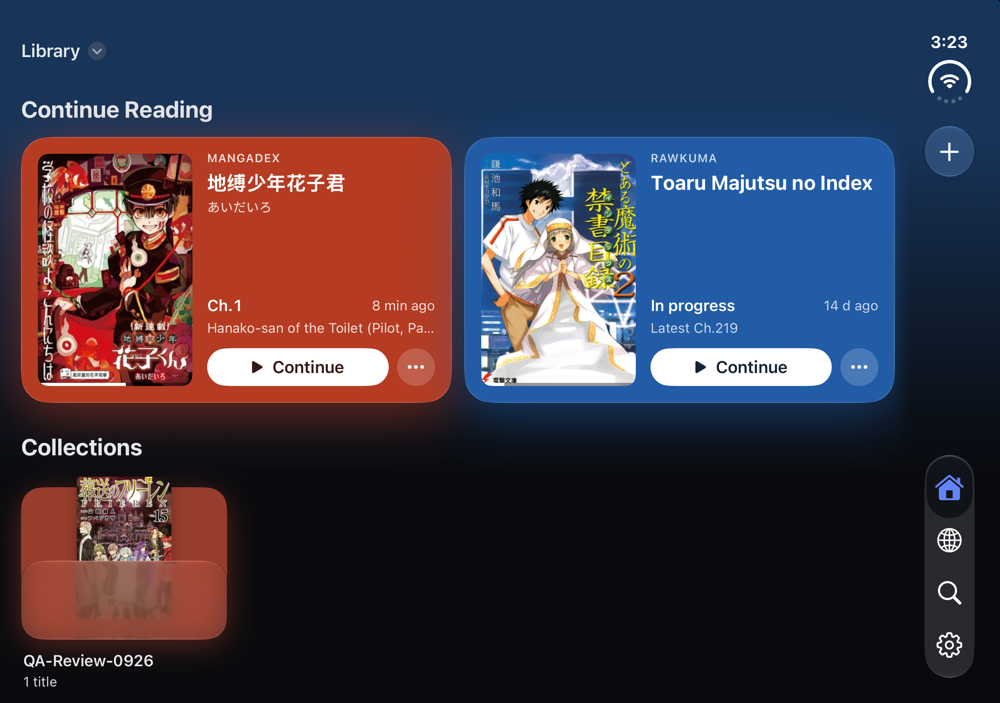

### Prototype controls and source loading (2026-10-12)

- Shelf/Grid keeps the selected A design: a compact glass capsule with a blue
  selection. Public UISegmentedControl handles tracking and selection animation,
  following Telegram's iOS 26+ control choice without copying private subview APIs.
- A native SwiftUI name alert owns its text and button validation. Cancel/Confirm
  roles and a cleared inherited tint restore system foreground colors. Empty
  names disable Create; entering a name gives the prominent blue/white action.
- Manage Sources uses compact rows, a selected checkmark, system row menus for
  reorder/remove, and glass add/done controls in prototype mode.
- Source tabs are 32pt. The source wash starts at the top; cover colors no longer
  receive an extra saturation boost. Included search chips regain their inset
  shadow. WCAG text contrast remains covered by the palette tests.
- iOS page padding no longer changes with delayed native header measurements.
  Root safe-area metrics and window insets seed first tab layouts.
- Source homes commit their complete result, keeping the prior home on refresh.
  Provisional runtime layouts do not replace the initial skeleton repeatedly.
  Home tabs wait for that first complete layout, and carousel width has a
  usable first-frame fallback. This applies to all sources.
- Prototype Library cards, shelves, local Search results, Browse sources and
  Settings source rows use UIKit context menus for long press. Native dismissal
  completion precedes action handoffs; previews have a clear rounded background.
  Continue Reading no longer shrinks its contents independently of the fill.

Validation: Xcode 27.1 RC simulator Release build and mobile typecheck passed.
Mobile coverage: 3918 passed / 0 failed; final focused layout/palette/source/depth
checks: 67 passed. Mobile lint: 0 errors / 63 warnings.

Inspected on the isolated Duo simulator: Library Shelf/Grid selection, Manage
Sources, empty/populated name alert, first visits to Browse/Search/Settings, and
Rawkuma's complete home. The native menu gesture/dismissal path still needs a
manual long-press check: the available pointer automation could not hold the
press long enough. Installed the verified build on the user's Duo, preserving
its data, and confirmed the inner-landscape Library launches.

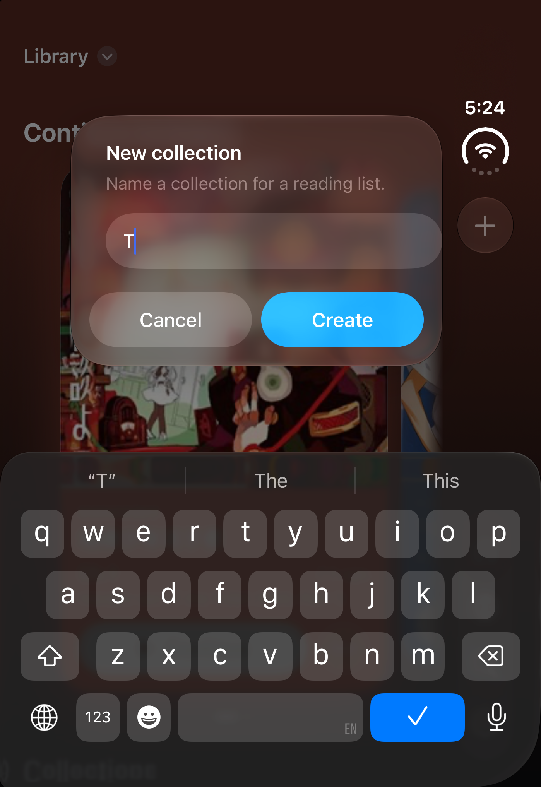
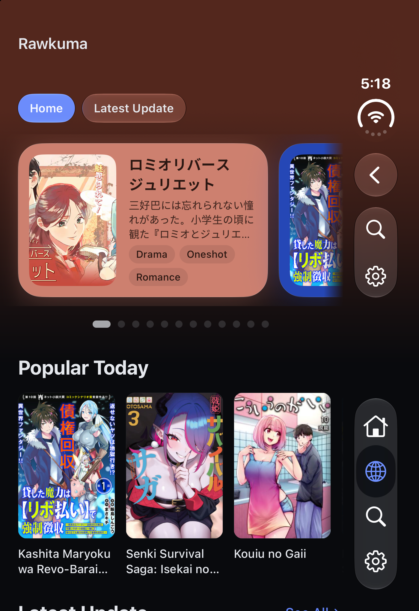
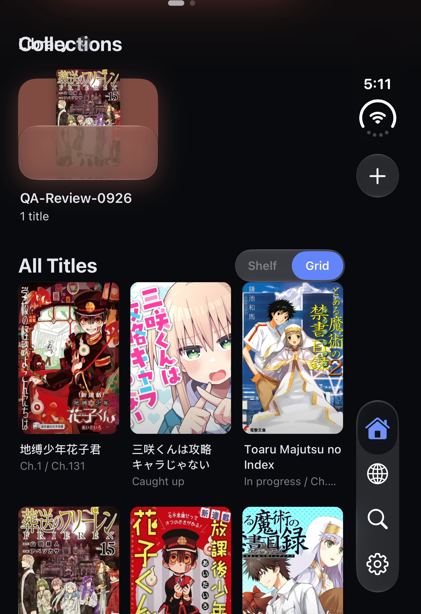

## Duo geometry, scroll edges, and compact source tabs — 2026-10-12

Source Home/Latest Update capsules are 28pt high with 11pt horizontal inset;
source pages use 8pt top padding from their first loading frame. Library Grid
retains the same 16pt first-cover headroom as Shelf.

Settings keeps one FlatList through compact/split presentation changes and
explicitly requests soft vertical scroll edges. SwiftUI form sheets also set
soft edges on the actual Form and put Close in cancellationAction placement.
The shared custom sheet scaffold uses the current bottom safe area; only short,
explicit fixed detents may use the full horizontal width on Duo. Tall/expanding
sheets retain the system side reservation. Open-source licenses has an explicit
close control.

Window observation now coalesces layout, margin, and safe-area notifications.
Page gutters use one native snapshot instead of combining old and new providers.
Container measurements are tagged with the window bounds, so a late outer-screen
callback cannot resize inner-screen panes. Search keeps an in-content search
field on both Duo displays, and source grids group rows without remounting their
header on column changes. Prototype UIKit window resizes no longer start or
restart the full-page blur veil; Reduce Motion retains a short unblurred fade.

Split View layout follows the app window, including its physical toolbar edge.
A division touching or outside that window is not used to force an even grid
column count. Narrow app windows keep a single pane. The app already opts out
of UIRequiresFullScreen; this work does not enable multiple Nemu scenes.

Detail artwork uses UIKit's public container-concentric corners (minimum 8pt).
The hero owns its 40pt gradient fade, with Chapters below it. On wide windows,
chapter rows put title, translation metadata, and reading progress alongside
one another, with a 44pt minimum height; narrow windows/large type retain stacked
rows. Top spacing next to a vertical bar is 24pt, an application design choice.

Apple reference: [Prepare your app for iPhone Duo, 4:30](https://developer.apple.com/videos/play/tech-talks/111461/?time=270)
shows ConcentricRectangle with padding(8), not a universal page margin. The
6:52–7:30 examples distinguish foreground safe areas from full-bleed backgrounds
and apply asymmetric edges independently. See also the
[iPhone Duo HIG](https://developer.apple.com/design/human-interface-guidelines/designing-for-iphone-duo).

Validation: Xcode 27.1 RC simulator Release build; mobile and root typechecks;
3,925 mobile tests passed with coverage; lint 0 errors / 63 existing warnings.
Focused geometry/sheet checks cover late display callbacks, off-window frames,
Split View boundary folds, narrow panes, and conservative sheet safe areas.

Isolated simulator checks: Shelf → Grid preserves the first cover's top;
Rawkuma Home/Latest Update has compact capsules and smaller top spacing; listing
results remain on display after folding; Settings root and Installed Sources
have visible first content in outer and unfolded layouts; Search outer/unfolded
layouts; tall licenses sheet leaves status controls unobscured; detail hero and
wide chapter rows. The final Settings unfold recording has no full-page blur.

Limit: actual left/right system Split View entry could not be completed using
the available pointer automation (home-indicator drags returned Home or stayed
full-screen; Device Hub accessibility timed out). Split View geometry tests pass,
but the two-app system gesture and all individual sheet workflows are not claimed
as manually verified. Screenshots cover the shared sheet/layout changes above.

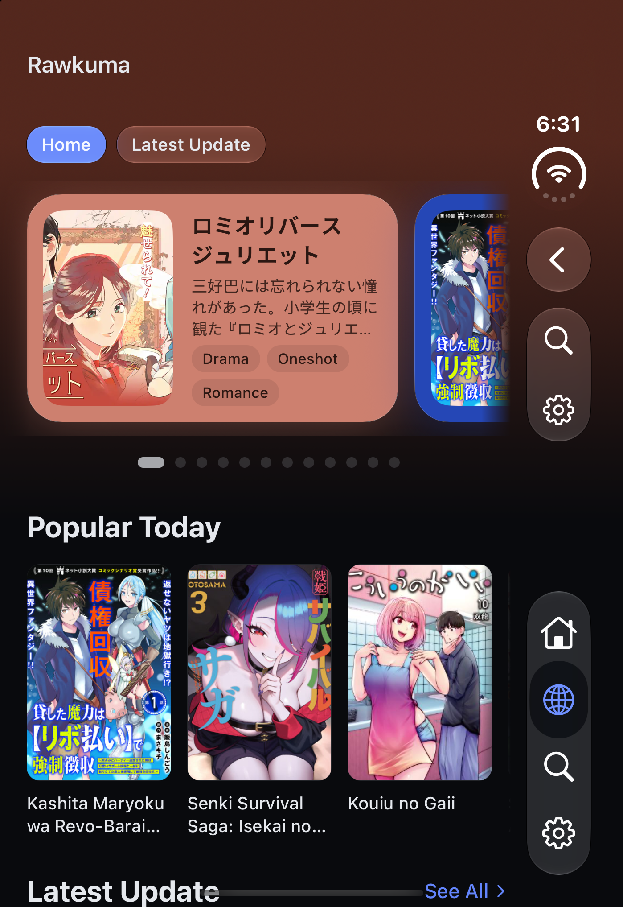
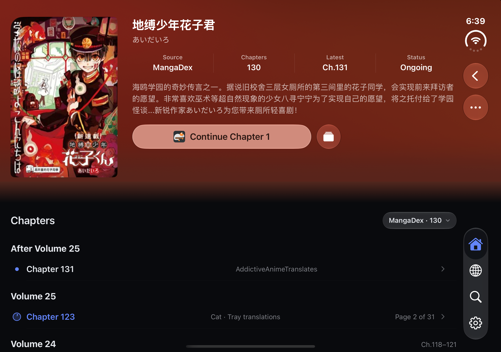
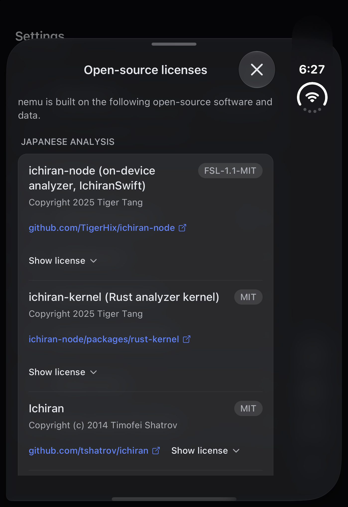
[Settings outer-to-inner recording](pr-34/duo-layout/settings-unfold.mp4)
